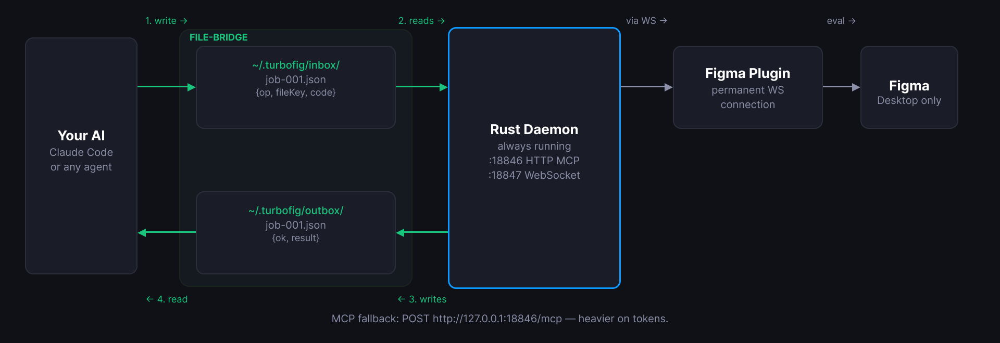

# How it works

*The daemon bridges your AI agent to the Figma plugin over a local
WebSocket.*

- The daemon is one Rust process. It runs the file bridge, the plugin
  WebSocket server, and the MCP HTTP endpoint (MCP mode only) as three
  tasks sharing one state.
- The file bridge (`~/.turbofig/inbox` and `outbox`) is the default path.
  An agent runs `turbofig js` (or writes a job file), the daemon's watcher
  picks the job up, and the agent reads the result file back. It loads no
  tool list and works where MCP servers are blocked.
- The Figma plugin UI holds a persistent WebSocket to the daemon, with
  infinite-backoff reconnect, so a plugin reopen re-pairs with no
  handshake.
- MCP is optional, for chat apps that cannot run a command. MCP HTTP
  (`POST /mcp`, port 18846) carries the pairing token as a Bearer auth
  header, and the daemon forwards the call to the plugin. It runs only when
  Connection is MCP (turbofig Settings, or the gear in the plugin). The
  stdio `turbofig mcp` proxy works in both modes.
- The plugin WebSocket upgrade requires a per-install pairing token
  (`~/.turbofig/token`), so a malicious web page cannot open the socket
  even though it shares the plugin iframe's null Origin.

See [reliability.md](reliability.md) for restart and retry behaviour, and
[mcp-clients.md](mcp-clients.md) for the MCP connection paths.
